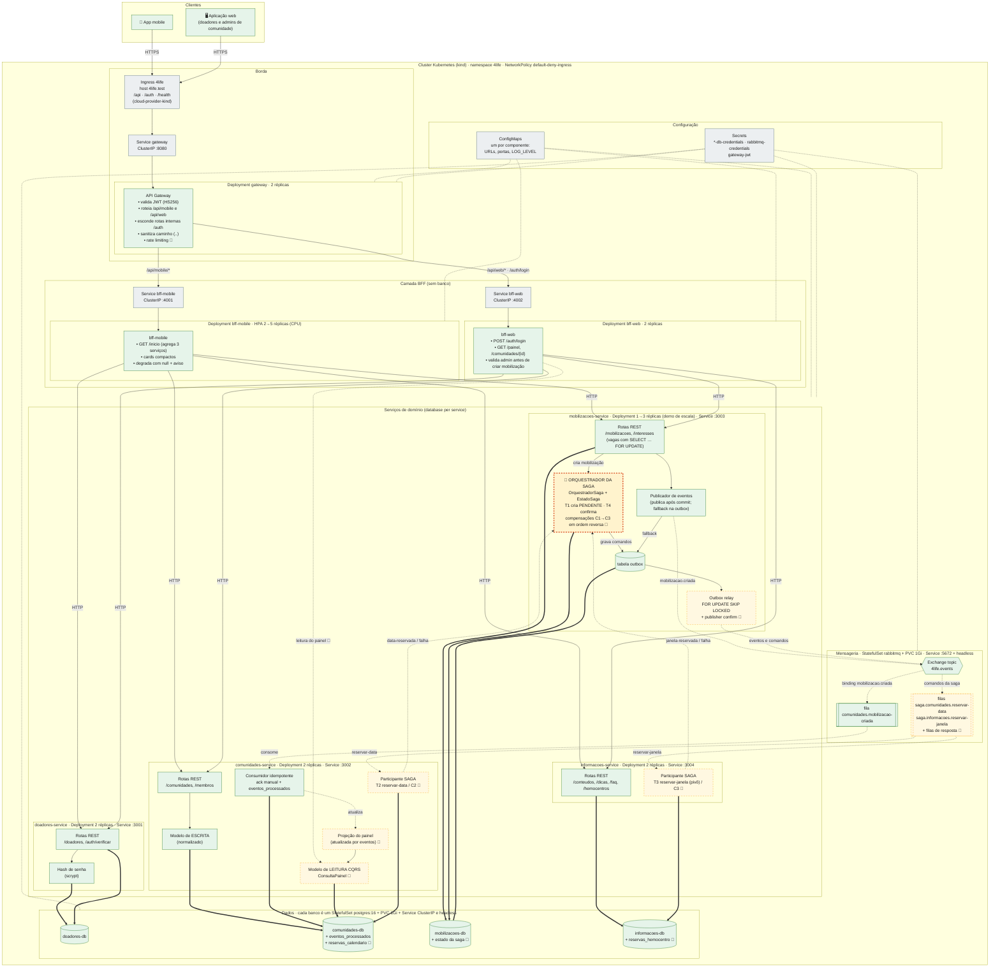

# 4Life — Diagrama completo da arquitetura

Um único diagrama com **todos** os componentes do sistema: clientes, borda, gateway, BFFs, os quatro
serviços de domínio com seus componentes internos (rotas, orquestrador da SAGA, outbox e relay,
consumidor idempotente, modelo de leitura do CQRS), bancos, broker, filas e os recursos do Kubernetes
que sustentam cada peça (Ingress, Services, Deployments, StatefulSets/PVCs, ConfigMaps, Secrets, HPA e
NetworkPolicies).

**Como ler:**

| Traço | Significado |
|---|---|
| `──▶` seta cheia | chamada **síncrona** HTTP/JSON |
| `-·-▶` seta pontilhada | mensagem **assíncrona** via RabbitMQ (evento, comando ou resposta) |
| `══` seta grossa | acesso ao **banco** (SQL) ou montagem de volume |
| caixa verde | implementado e rodando no protótipo |
| caixa amarela tracejada | desenho-alvo (Parte 4): contrato definido, implementação pendente |
| caixa cinza | recurso de infraestrutura (Kubernetes / Docker) |

## Componentes, um a um

| # | Componente | Onde roda | Responsabilidade | Estado |
|---|---|---|---|---|
| 1 | Ingress `4life` | cloud-provider-kind, host `4life.test` | Única entrada HTTP do cluster; só encaminha `/api`, `/auth` e `/health` ao gateway | ✅ |
| 2 | API Gateway | Deployment `gateway` (2 réplicas) | JWT, roteamento por prefixo, esconde `/auth` interno, sanitização | ✅ (rate limiting 📐) |
| 3 | bff-mobile | Deployment + **HPA 2→5** | Agrega dados para telas curtas do app | ✅ |
| 4 | bff-web | Deployment (2 réplicas) | Login, painéis e administração de comunidades | ✅ |
| 5 | doadores-service | Deployment (2) + `doadores-db` | Cadastro, perfil e verificação de credenciais | ✅ |
| 6 | comunidades-service | Deployment (2) + `comunidades-db` | Comunidades, membros, consumidor de `mobilizacao.criada` | ✅ |
| 7 | Consumidor idempotente | dentro de comunidades | `ack` manual + tabela `eventos_processados` | ✅ |
| 8 | Modelo de leitura CQRS | dentro de comunidades | Projeção desnormalizada do painel (defasagem ≤ 5 s) | 📐 |
| 9 | mobilizacoes-service | Deployment (1 → 3 na demo) + `mobilizacoes-db` | Mobilizações, interesses e controle de vagas | ✅ |
| 10 | **Orquestrador da SAGA** | dentro de mobilizacoes | Conduz T1→T4, persiste o estado e dispara C1→C3 em ordem reversa | 📐 (contratos em `src/saga/contratos.ts`) |
| 11 | Tabela outbox | `mobilizacoes-db` | Evento/comando gravado junto da mudança de domínio | ✅ (hoje só como fallback) |
| 12 | Outbox relay | dentro de mobilizacoes | Publica pendências com `SKIP LOCKED` + publisher confirm | 📐 (`src/outbox/relay.ts`) |
| 13 | Participante SAGA — comunidades | dentro de comunidades | T2 reservar data / C2 remover reserva | 📐 |
| 14 | informacoes-service | Deployment (2) + `informacoes-db` | Conteúdos, dicas, FAQ e hemocentros | ✅ |
| 15 | Participante SAGA — informacoes | dentro de informacoes | T3 reservar janela no hemocentro (pivô) / C3 | 📐 |
| 16 | RabbitMQ | StatefulSet + PVC | Exchange topic `4life.events`, filas de eventos e da saga | ✅ |
| 17 | 4 PostgreSQL | StatefulSets + PVC 1Gi cada | Um banco por serviço, sem acesso cruzado | ✅ |
| 18 | ConfigMaps | um por componente | URLs dos serviços, portas, `LOG_LEVEL` | ✅ |
| 19 | Secrets | `*-db-credentials`, `rabbitmq-credentials`, `gateway-jwt` | Senhas e chave do JWT, nunca no Git | ✅ |
| 20 | NetworkPolicies | namespace `4life` | default-deny; cada camada só aceita a camada de cima; banco só aceita o próprio serviço | ✅ |

## Isolamento (vale para Compose e Kubernetes)

- Gateway → só BFFs. BFFs → só serviços. Serviço → só o **próprio** banco e o RabbitMQ (se usar eventos).
- No **Docker Compose** isso é feito com as redes `edge`, `app`, `bus` e `data-<serviço>` (todas `internal`,
  exceto `edge`). No **Kubernetes**, com `NetworkPolicy` + `default-deny-ingress`.
- O `mobilizacoes-service` começa com 1 réplica de propósito, para a demonstração `1 → 3`
  (`scripts/demo-escala.sh`). Como o orquestrador persiste o estado da saga e o relay usa `SKIP LOCKED`,
  várias réplicas podem rodar sem duplicar trabalho.
