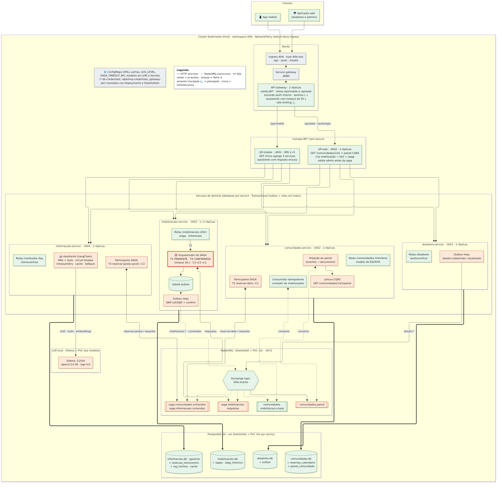

# 4Life — Diagrama completo da arquitetura

Um único diagrama com **todos** os componentes do sistema: clientes, borda, gateway, BFFs, os quatro
serviços de domínio com seus componentes internos (rotas, orquestrador da SAGA, participantes, outbox e
relay, consumidores idempotentes, modelo de leitura do CQRS, assistente com RAG), o LLM local (Ollama),
bancos (com pgvector), broker, filas e os recursos do Kubernetes
que sustentam cada peça (Ingress, Services, Deployments, StatefulSets/PVCs, ConfigMaps, Secrets, HPA e
NetworkPolicies).

Versão em imagem, mais compacta, em [`imagens/diagrama-completo.png`](../imagens/diagrama-completo.png) e em vetor (zoom sem perder nitidez) em [`imagens/diagrama-completo.svg`](../imagens/diagrama-completo.svg); o código-fonte dela fica em [`imagens/diagrama-completo.mmd`](../imagens/diagrama-completo.mmd).

**Como ler:**

| Traço | Significado |
|---|---|
| `──▶` seta cheia | chamada **síncrona** HTTP/JSON |
| `-·-▶` seta pontilhada | mensagem **assíncrona** via RabbitMQ (evento, comando ou resposta) |
| `══` seta grossa | acesso ao **banco** (SQL) ou montagem de volume |
| caixa verde | implementado e rodando |
| caixa laranja | componentes da Parte 4 (SAGA, outbox + relay, CQRS, assistente com LLM) |
| caixa amarela tracejada | ainda planejado (só o rate limiting do gateway) |
| caixa cinza | recurso de infraestrutura (Kubernetes / Docker) |

```mermaid
flowchart TB
    %% ================================================================ CLIENTES
    subgraph CLI["Clientes"]
        APP["📱 App mobile"]
        WEB["🖥️ Aplicação web<br/>(doadores e admins de comunidade)"]
    end

    %% ================================================================ CLUSTER
    subgraph K8S["Cluster Kubernetes (kind) · namespace 4life · NetworkPolicy default-deny-ingress"]
        direction TB

        %% ------------------------------------------------------------ BORDA
        subgraph EDGE["Borda"]
            ING["Ingress 4life<br/>host 4life.test<br/>/api · /auth · /health<br/>(cloud-provider-kind)"]
            GWSVC["Service gateway<br/>ClusterIP :8080"]
            subgraph GWDEP["Deployment gateway · 2 réplicas"]
                GW["API Gateway<br/>• valida JWT (HS256)<br/>• roteia /api/mobile e /api/web<br/>• /assistente com timeout de 55 s<br/>• esconde rotas internas /auth<br/>• sanitiza caminho (..)"]
                RL["rate limiting 📐"]
            end
        end

        %% ------------------------------------------------------------ BFFs
        subgraph BFFS["Camada BFF (sem banco)"]
            BMSVC["Service bff-mobile<br/>ClusterIP :4001"]
            BWSVC["Service bff-web<br/>ClusterIP :4002"]
            subgraph BMDEP["Deployment bff-mobile · HPA 2→5 réplicas (CPU)"]
                BM["bff-mobile<br/>• GET /inicio (agrega 3 serviços)<br/>• cards compactos<br/>• POST /assistente/perguntar (enxuto)"]
            end
            subgraph BWDEP["Deployment bff-web · 2 réplicas"]
                BW["bff-web<br/>• POST /auth/login · GET /painel<br/>• GET /comunidades/{id} = painel CQRS<br/>• cria mobilização → 202 + /saga<br/>• POST /assistente/perguntar"]
            end
        end

        %% ------------------------------------------------------------ DOMÍNIO
        subgraph DOM["Serviços de domínio (database per service · Transactional Outbox em todos)"]

            subgraph DOA["doadores-service · Deployment 2 réplicas · Service :3001"]
                DOA_R["Rotas REST<br/>/doadores, /auth/verificar<br/>(hash scrypt)"]
                DOA_RL["Outbox relay<br/>doador.cadastrado / atualizado"]
            end

            subgraph COM["comunidades-service · Deployment 2 réplicas · Service :3002"]
                COM_R["Rotas REST — modelo de ESCRITA<br/>/comunidades, /membros<br/>(evento na outbox na mesma transação)"]
                COM_C["Consumidor idempotente<br/>contador de mobilizações"]
                COM_P["Projeção do painel<br/>(fila comunidades.painel)"]
                COM_Q["Modelo de LEITURA CQRS<br/>GET /comunidades/{id}/painel"]
                COM_SP["Participante SAGA<br/>T2 reservar-data / C2"]
                COM_RL["Outbox relay"]
            end

            subgraph MOB["mobilizacoes-service · Deployment 1→3 réplicas · Service :3003"]
                MOB_R["Rotas REST<br/>/mobilizacoes (202), /saga, /interesses<br/>(vagas com SELECT … FOR UPDATE)"]
                ORQ["🎯 ORQUESTRADOR DA SAGA<br/>estado em sagas + saga_historico<br/>T1 PENDENTE · T4 CONFIRMADA<br/>timeout 30 s · C3→C2→C1"]
                RELAY["Outbox relay<br/>FOR UPDATE SKIP LOCKED<br/>+ publisher confirm + backoff"]
            end

            subgraph INF["informacoes-service · Deployment 2 réplicas · Service :3004"]
                INF_R["Rotas REST<br/>/conteudos, /faq, /hemocentros"]
                INF_SP["Participante SAGA<br/>T3 reservar-janela (pivô) / C3"]
                INF_AI["🤖 Assistente (LangChain)<br/>RAG + tools · circuit breaker<br/>timeout/retry · cache · fallback"]
                INF_RL["Outbox relay"]
            end
        end

        %% ------------------------------------------------------------ LLM
        subgraph LLM["LLM local · Deployment ollama + PVC 4Gi (modelos) · Job ollama-modelos"]
            OLL["Ollama :11434<br/>qwen2.5:0.5b (geração + tools)<br/>bge-m3 (embeddings)"]
        end

        %% ------------------------------------------------------------ MENSAGERIA
        subgraph BUS["Mensageria · StatefulSet rabbitmq + PVC 1Gi · Service :5672 + headless"]
            EX{{"Exchange topic<br/>4life.events"}}
            Q1[["comunidades.mobilizacao-criada"]]
            QP[["comunidades.painel"]]
            Q2[["saga.comunidades.comandos<br/>saga.informacoes.comandos"]]
            QR[["saga.mobilizacoes.respostas"]]
        end

        %% ------------------------------------------------------------ DADOS
        subgraph DATA["Dados · cada banco é um StatefulSet PostgreSQL 16 + PVC 1Gi + Service ClusterIP e headless"]
            DOA_DB[("doadores-db<br/>+ outbox")]
            COM_DB[("comunidades-db<br/>+ reservas_calendario<br/>+ painel_comunidade<br/>+ eventos_processados · outbox")]
            MOB_DB[("mobilizacoes-db<br/>+ sagas · saga_historico<br/>+ outbox · eventos_processados")]
            INF_DB[("informacoes-db (pgvector)<br/>+ reservas_hemocentro<br/>+ rag_trechos · assistente_cache<br/>+ outbox")]
        end

        %% ------------------------------------------------------------ CONFIG
        subgraph CFG["Configuração"]
            CM["ConfigMaps<br/>um por componente:<br/>URLs, portas, LOG_LEVEL,<br/>SAGA_TIMEOUT_MS, modelos do LLM"]
            SEC["Secrets<br/>*-db-credentials · rabbitmq-credentials<br/>gateway-jwt"]
        end
    end

    %% ================================================================ FLUXO SÍNCRONO
    APP -->|HTTPS| ING
    WEB -->|HTTPS| ING
    ING --> GWSVC --> GW
    GW -->|/api/mobile/*| BMSVC --> BM
    GW -->|/api/web/* · /auth/login| BWSVC --> BW

    BM -->|HTTP| DOA_R
    BM -->|HTTP| COM_R
    BM -->|HTTP| MOB_R
    BM -->|HTTP| INF_R
    BM -->|HTTP| INF_AI
    BW -->|HTTP| DOA_R
    BW -->|HTTP| COM_R
    BW -->|HTTP| MOB_R
    BW -->|HTTP| INF_R
    BW -->|painel| COM_Q
    BW -->|HTTP| INF_AI

    %% ================================================================ INTERNO DOS SERVIÇOS
    MOB_R -->|T1| ORQ
    COM_P --> COM_Q
    INF_AI -->|HTTP: chat, tools e embeddings| OLL

    %% ================================================================ BANCOS
    DOA_R ==> DOA_DB
    DOA_RL ==> DOA_DB
    COM_R ==> COM_DB
    COM_C ==> COM_DB
    COM_P ==> COM_DB
    COM_Q ==> COM_DB
    COM_SP ==> COM_DB
    COM_RL ==> COM_DB
    MOB_R ==> MOB_DB
    ORQ ==> MOB_DB
    RELAY ==> MOB_DB
    INF_R ==> INF_DB
    INF_SP ==> INF_DB
    INF_AI ==>|pgvector + tools| INF_DB
    INF_RL ==> INF_DB

    %% ================================================================ ASSÍNCRONO
    DOA_RL -.->|doador.*| EX
    COM_RL -.->|comunidade.* · membro.* · respostas T2/C2| EX
    RELAY -.->|mobilizacao.* · comandos da saga| EX
    INF_RL -.->|respostas T3/C3| EX
    EX -.-> Q1
    EX -.-> QP
    EX -.-> Q2
    EX -.-> QR
    Q1 -.->|consome| COM_C
    QP -.->|consome| COM_P
    Q2 -.->|reservar/liberar data| COM_SP
    Q2 -.->|reservar/liberar janela| INF_SP
    QR -.->|respostas| ORQ

    %% ================================================================ CONFIG
    CM -.- GWDEP
    CM -.- BMDEP
    CM -.- BWDEP
    CM -.- DOM
    SEC -.- GWDEP
    SEC -.- DOM
    SEC -.- DATA
    SEC -.- BUS

    %% ================================================================ ESTILOS
    classDef impl fill:#e6f4ea,stroke:#2e7d32,color:#1b1b1b
    classDef p4 fill:#fde9d9,stroke:#d84315,color:#1b1b1b
    classDef alvo fill:#fff8e1,stroke:#f9a825,stroke-dasharray:5 4,color:#1b1b1b
    classDef infra fill:#eceff1,stroke:#546e7a,color:#1b1b1b
    classDef orq fill:#fde9d9,stroke:#d84315,stroke-width:3px,color:#1b1b1b

    class APP,WEB,GW,BM,BW,DOA_R,COM_R,COM_C,MOB_R,INF_R,EX,Q1,DOA_DB,COM_DB,MOB_DB,INF_DB impl
    class COM_P,COM_Q,COM_SP,RELAY,DOA_RL,COM_RL,INF_RL,INF_SP,INF_AI,OLL,QP,Q2,QR p4
    class RL alvo
    class ORQ orq
    class ING,GWSVC,BMSVC,BWSVC,CM,SEC infra
```

## Componentes, um a um

| # | Componente | Onde roda | Responsabilidade | Estado |
|---|---|---|---|---|
| 1 | Ingress `4life` | cloud-provider-kind, host `4life.test` | Única entrada HTTP do cluster; só encaminha `/api`, `/auth` e `/health` ao gateway | ✅ |
| 2 | API Gateway | Deployment `gateway` (2 réplicas) | JWT, roteamento por prefixo, esconde `/auth` interno, sanitização, timeout maior para `/assistente` | ✅ (rate limiting 📐) |
| 3 | bff-mobile | Deployment + **HPA 2→5** | Agrega dados para telas curtas do app; assistente com resposta enxuta | ✅ |
| 4 | bff-web | Deployment (2 réplicas) | Login, painéis (lê o modelo de leitura), criação de mobilização (202) e acompanhamento da saga | ✅ |
| 5 | doadores-service | Deployment (2) + `doadores-db` | Cadastro, perfil, credenciais; publica `doador.*` pela outbox | ✅ |
| 6 | comunidades-service | Deployment (2) + `comunidades-db` | Comunidades e membros (escrita), eventos pela outbox | ✅ |
| 7 | Consumidores idempotentes | comunidades, mobilizacoes, informacoes | `ack` manual + `eventos_processados (evento_id, consumidor)` | ✅ |
| 8 | Modelo de leitura CQRS | dentro de comunidades | Projeção `painel_comunidade` atualizada por eventos; consulta em 1 chamada; defasagem medida ~0,5 s | ✅ Parte 4 |
| 9 | mobilizacoes-service | Deployment (1 → 3 na demo) + `mobilizacoes-db` | Mobilizações, interesses e controle de vagas | ✅ |
| 10 | **Orquestrador da SAGA** | dentro de mobilizacoes | Conduz T1→T4, persiste estado e histórico, timeout por passo, compensações C3→C2→C1 | ✅ Parte 4 |
| 11 | Tabela outbox | nos 4 bancos | Evento/comando gravado na mesma transação da mudança de domínio | ✅ Parte 4 |
| 12 | Outbox relay | doadores, comunidades, mobilizacoes, informacoes | Publica pendências com `SKIP LOCKED` + publisher confirm + backoff | ✅ Parte 4 |
| 13 | Participante SAGA: comunidades | dentro de comunidades | T2 valida admin e reserva a data / C2 libera | ✅ Parte 4 |
| 14 | informacoes-service | Deployment (2) + `informacoes-db` | Conteúdos, dicas, FAQ e hemocentros (com capacidade diária) | ✅ |
| 15 | Participante SAGA: informacoes | dentro de informacoes | T3 reserva janela no hemocentro (pivô) / C3 libera | ✅ Parte 4 |
| 16 | **Assistente com RAG** | dentro de informacoes | LangChain (chain + tools), pgvector, circuit breaker, timeout/retry, cache, fallback | ✅ Parte 4 |
| 17 | Ollama | Deployment + PVC 4Gi + Job de download | LLM local `qwen2.5:0.5b` e embeddings `bge-m3`; só o informacoes-service acessa | ✅ Parte 4 |
| 18 | RabbitMQ | StatefulSet + PVC | Exchange topic `4life.events`; filas de eventos, do painel, de comandos e de respostas da saga | ✅ |
| 19 | 4 PostgreSQL | StatefulSets + PVC 1Gi cada | Um banco por serviço, sem acesso cruzado; `informacoes-db` com pgvector | ✅ |
| 20 | ConfigMaps | um por componente | URLs dos serviços, portas, `LOG_LEVEL`, timeout da saga, modelos do LLM | ✅ |
| 21 | Secrets | `*-db-credentials`, `rabbitmq-credentials`, `gateway-jwt` | Senhas e chave do JWT, nunca no Git | ✅ |
| 22 | NetworkPolicies | namespace `4life` | default-deny; cada camada só aceita a camada de cima; banco só aceita o próprio serviço; Ollama só aceita o informacoes | ✅ |

## Isolamento (vale para Compose e Kubernetes)

- Gateway → só BFFs. BFFs → só serviços. Serviço → só o **próprio** banco e o RabbitMQ (se usar eventos).
  Só o informacoes-service alcança o Ollama (rede `llm` no compose; NetworkPolicy no Kubernetes).
- No **Docker Compose** isso é feito com as redes `edge`, `app`, `bus` e `data-<serviço>` (todas `internal`,
  exceto `edge`). No **Kubernetes**, com `NetworkPolicy` + `default-deny-ingress`.
- O `mobilizacoes-service` começa com 1 réplica de propósito, para a demonstração `1 → 3`
  (`scripts/demo-escala.sh`). Como o orquestrador persiste o estado da saga e o relay usa `SKIP LOCKED`,
  várias réplicas podem rodar sem duplicar trabalho.
